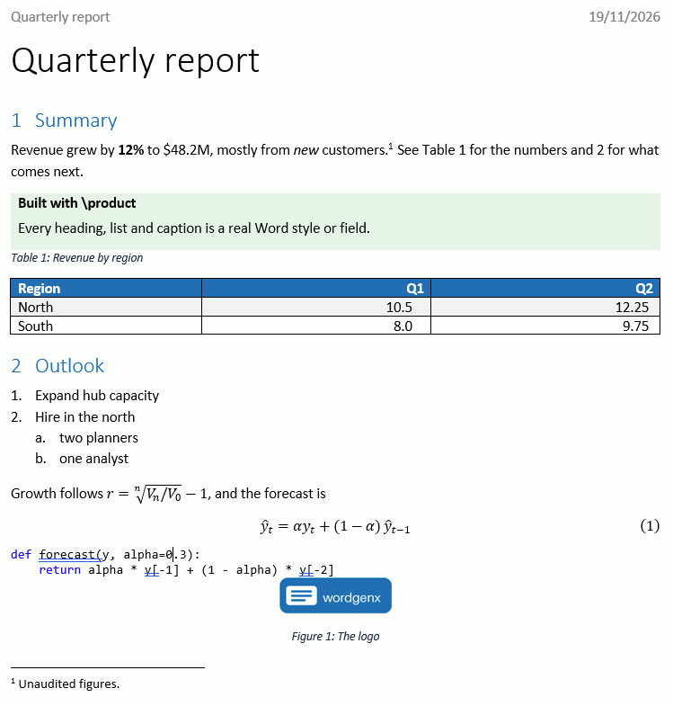

# ReDocx

ReDocx is a language (and its implementation) that compiles to **native, fully formatted Word (.docx) documents**.

Its primary purpose is to facilitate automated generation of fully formatted DOCX documents. With it, you don't need complex libraries or fragile template-based generators; just write plain text using any template engine and compile it!

The syntax of ReDocx is inspired by TeX, but is a separate language tailored to reflect the structure and features of the DOCX format.

ReDocx aims to support the majority of its features, including math, graphics, complex layouts and only missing certain technical features such as editing history and data connection.

Despite its primary purpose being automated document generation, ReDocx is designed to be human-readable and writable (although decompiler could produce rather messy sources). It, in fact, provides certain advantages over the GUI editors, such as:

 - Writing math formulas using LaTeX
 - Code blocks with syntax highlighting
 - And even BibTeX bibliographies

At its current state, ReDocx is functionally complete.

## AI use disclaimer

ReDocx is a vibeware. The only text mostly written by human is this readme file. It is useful for the author, hope it could be useful for someone else.

## Example

````tex
\document[lang=en-GB]
\meta[title="Quarterly report", author="Jane Doe"]
\section[size=A4, margins=2cm]
\header{Quarterly report \tab \tab \field{DATE}}
\footer{\align[center]{Page \pagenum of \numpages}}

\styles{
  modify paragraph "Heading 1" { color: theme.accent1; space-before: 12pt; numbering: Headings level 1; }
  numbering Headings { level 1 { format: decimal; text: "%1"; } }
  table "Data Grid" : "Table Grid" {
    header-row { bold; color: #FFFFFF; shading: theme.accent1; }
    banded-rows { odd { shading: #F2F2F2; } }
  }
}

\let{product}{ReDocx}

\p[style=Title]{Quarterly report}

= Summary {#sec:summary}

Revenue grew by *12%* to $48.2M, mostly from _new_ customers.\footnote{Unaudited figures.}
See @tbl:rev for the numbers and @sec:outlook for what comes next.

\tip[title="Built with \product"]{Every heading, list and caption is a real Word style or field.}

\caption[Table, id=tbl:rev]{Revenue by region}
\table[style="Data Grid", header-rows=1, widths=(5cm, 1fr, 1fr), columns=(left, decimal, decimal)]{
  | Region | Q1   | Q2    |
  | North  | 10.5 | 12.25 |
  | South  | 8.0  | 9.75  |
}

= Outlook {#sec:outlook}

1. Expand hub capacity
2. Hire in the north
   a. two planners
   b. one analyst

Growth follows \m{r = \sqrt[n]{V_n / V_0} - 1}, and the forecast is

$$ \hat{y}_t = \alpha y_t + (1-\alpha)\,\hat{y}_{t-1} $$ {#eq:ses}

```python
def forecast(y, alpha=0.3):
    return alpha * y[-1] + (1 - alpha) * y[-2]
```

\figure[id=fig:logo, width=3cm, align=center]{
  \image{img/logo.png}
  \caption{The logo}
}
````

`redocx build examples/readme-sample.rdx` turns it into this Word document:



## The ReDocx language

- [redocx in one page](docs/guide/README.md): the short guide, with links to the topic guides (tables, pictures,
  styles, references, sections, math and code, macros, forms, import).
- [Generating documents](docs/guide/generating.md): writing source from a program or Jinja, escaping data,
  compiling from scripts.
- [For TeX users](docs/guide/tex.md): some LaTeX constructs and their nearest redocx equivalents.
- [Command reference](docs/reference.md): every command, option and formatting property, generated from the
  compiler's own tables (`python tools/make_reference.py`).

## Installation

ReDocx needs Python 3.12 or later. Each command below puts `redocx` on your `PATH`.

From GitHub, with [uv](https://docs.astral.sh/uv/) (it installs Python if needed), pipx or pip:

```bash
uv tool install git+https://github.com/dmishin/redocx
pipx install git+https://github.com/dmishin/redocx
pip install git+https://github.com/dmishin/redocx
```

From a clone of the repository:

```bash
git clone https://github.com/dmishin/redocx
cd redocx
uv tool install .          # or: pip install .
```

Without installing, `uv run redocx ...` inside the clone runs the current source.

ReDocx is not on PyPI yet. Once it is, `uv tool install redocx`, `pipx install redocx` or
`pip install redocx` will work.

To use ReDocx from Python code (for example `redocx.escape` or `redocx.compiler.compile_source`), install it into your
project's environment instead: `uv add git+https://github.com/dmishin/redocx` or the `pip install` line above.

## Using ReDocx

```bash
redocx build examples/hello.rdx               # compile to examples/hello.docx
redocx build examples/hello.rdx --validate    # also check every part against the schemas
redocx check examples/syntax-tour.rdx         # compile and report diagnostics, write nothing
redocx fmt examples/hello.rdx                 # rewrite in the canonical layout (--check, --diff)
redocx explain table                          # a command, property, macro or std: module
redocx explain note --in examples/hello.rdx   # ... including the document's own macros
redocx inspect examples/hello.docx            # read a .docx back, report structure and coverage
redocx import examples/hello.docx -o hello    # turn a .docx into source: .rdx, .rdxs, pictures, report
redocx import report.docx --keep-styles       # ... compiling into the original's styles as a template
redocx import report.docx --commands-only     # ... with commands only, no sugar (level L1)
redocx import report.docx --check             # ... failing unless it compiles to what the original was
```

## Development
### Design documents

| # | Document | What it covers |
|---|----------|----------------|
| 1 | [Vision & scope](docs/01-vision-and-scope.md) | Goals, non-goals, principles, prior art, what is and isn't possible |
| 2 | [Implementation language](docs/02-adr-implementation-language.md) | Python vs .NET vs Java vs Rust vs JS, and the decision |
| 3 | [Language design](docs/03-language-design.md) | Syntax, commands, styles, lists, tables, math, macros, escape hatches |
| 4 | [Architecture](docs/04-architecture.md) | Compiler pipeline, intermediate representation, OOXML writer, templates |
| 5 | [Feature matrix](docs/05-feature-matrix.md) | Word features × implementation tier |
| 6 | [Roadmap](docs/06-roadmap.md) | Milestones M0–M8 and exit criteria |
| 7 | [Testing strategy](docs/07-testing-strategy.md) | How we know the output is correct |
| 8 | [Decisions & open questions](docs/08-open-questions.md) | Decision log and what is still open |
| 9 | [Postponed features](docs/09-postponed.md) | What is left out on purpose, and known gaps |

### Development status

Milestones M0–M8 are done (see the [roadmap](docs/06-roadmap.md)): styles and style sheets, lists with
real Word numbering, tables, pictures, captions and cross-references, fields, notes, math, code, citations, sections,
text boxes, forms, comments, templates, importing Word documents back to source, and (M7) checks that what compiles
opens in Word, a command reference, guides and `redocx explain`, and (M8) generation: `redocx.escape`, standard
input and output, JSON diagnostics and `--root`. The grammar is frozen since 0.1.0; see the
[changelog](CHANGELOG.md).

### Running examples

See [CONTRIBUTING](CONTRIBUTING.md) for what a change includes and how it is checked.

Requirements: [uv](https://docs.astral.sh/uv/) (it installs Python 3.12+ if needed) and, for the OOXML validator
tests, the [.NET SDK](https://dotnet.microsoft.com/download) 8 or later.

```bash
uv sync                    # create .venv with dev dependencies
uv run pytest              # tests (validator tests are skipped without the .NET SDK)
uv run ruff check          # lint
uv run ruff format         # format
uv run pyright             # strict type check
uv run redocx build examples/hello.rdx             # compile to examples/hello.docx
uv run redocx check examples/syntax-tour.rdx       # compile and report diagnostics, write nothing
uv run redocx fmt examples/hello.rdx               # rewrite in the canonical layout (--check, --diff)
uv run redocx build examples/hello.rdx --emit-ir - # also print the IR as JSON
uv run redocx build examples/hello.rdx --validate  # also check every part against the schemas
uv run redocx parse examples/syntax-tour.rdx       # print the AST (--tree cst for the CST)
uv run redocx explain table                        # a command, property, macro or std: module
uv run redocx explain note --in examples/hello.rdx # ... including the document's own macros
uv run redocx inspect examples/hello.docx          # read a .docx back, report structure and coverage
uv run redocx import examples/hello.docx -o hello  # turn a .docx into source: .rdx, .rdxs, pictures, report
uv run redocx import report.docx --keep-styles    # ... compiling into the original's styles as a template
uv run redocx import report.docx --commands-only  # ... with commands only, no sugar (level L1)
uv run redocx import report.docx --check          # ... failing unless it compiles to what the original was
```

Golden snapshots (`tests/golden/expected/`) record the exact XML of each test document. After an intended output
change, regenerate them and review the diff before committing:

```bash
REDOCX_UPDATE_GOLDEN=1 uv run pytest tests/golden
```

Every golden document is also validated against the ECMA-376 schemas (`src/redocx/data/schemas/`) and by Microsoft's Open XML SDK.

Layout: `src/redocx/` (package), `tests/`, `src/redocx/data/schemas/` (XSDs), `tools/ooxml-validate/` (.NET validator,
CI and dev only), `docs/` (design), `examples/` (sample sources).

### Python API (early)

```python
from redocx import ir
from redocx.props import para_props, run_props
from redocx.ooxml.writer import write_docx

doc = ir.Document(
    styles=(
        ir.paragraph_style(
            "Heading 1",
            next="Normal",
            paragraph=para_props(keep_with_next=True, outline_level=1),
            run=run_props(font="theme.major", size="16pt", color="theme.accent1"),
        ),
    ),
    body=(
        ir.paragraph("Hello", style="Heading 1"),
        ir.paragraph("Plain text and ", ir.run("bold text", bold=True), ".", align="justify"),
    ),
)
write_docx(doc, "hello.docx")
```

## License

Open source. Apache-2.0.
